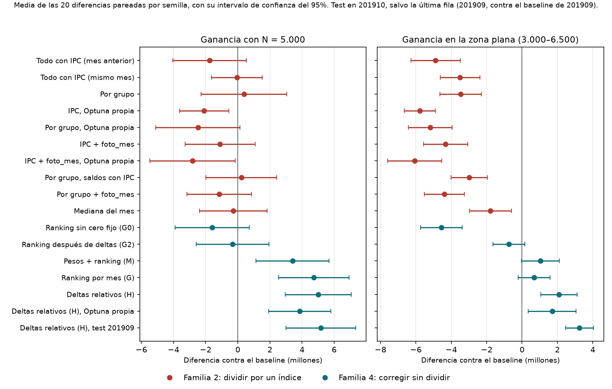
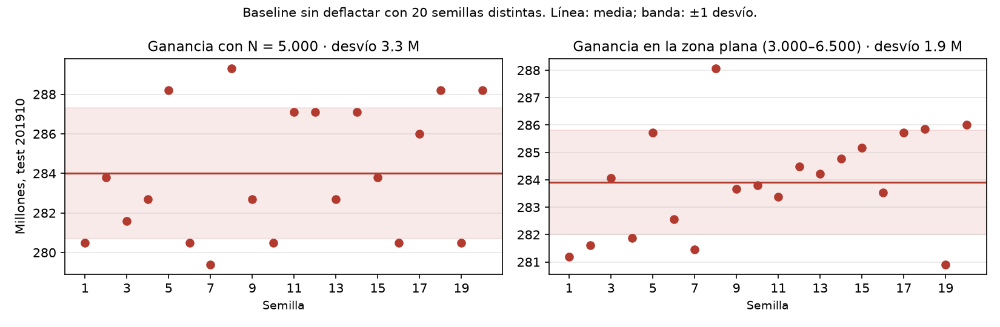
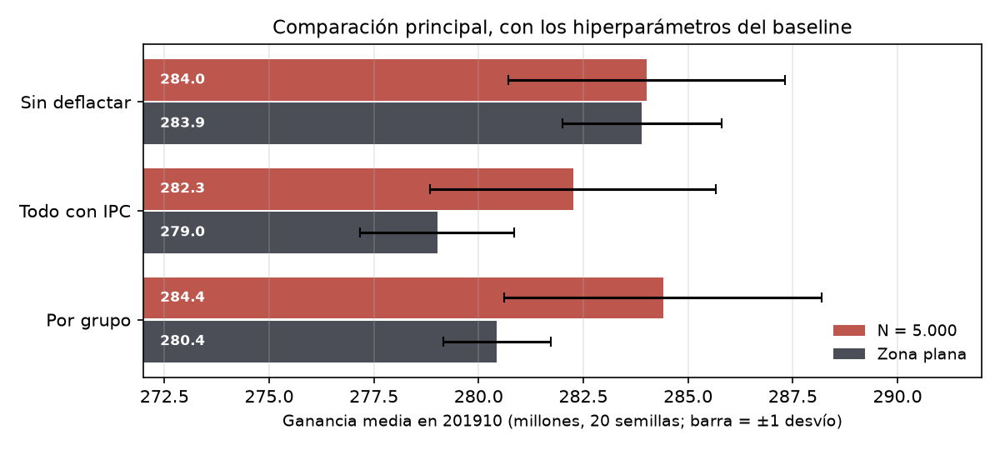
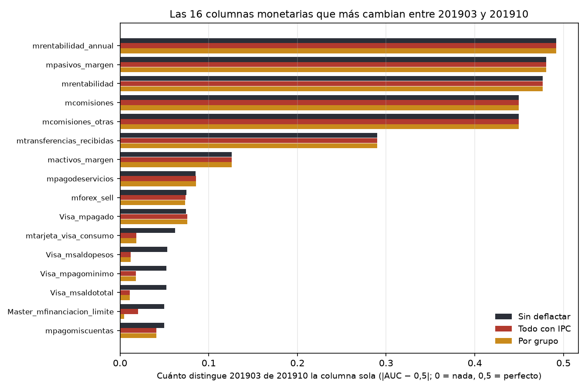
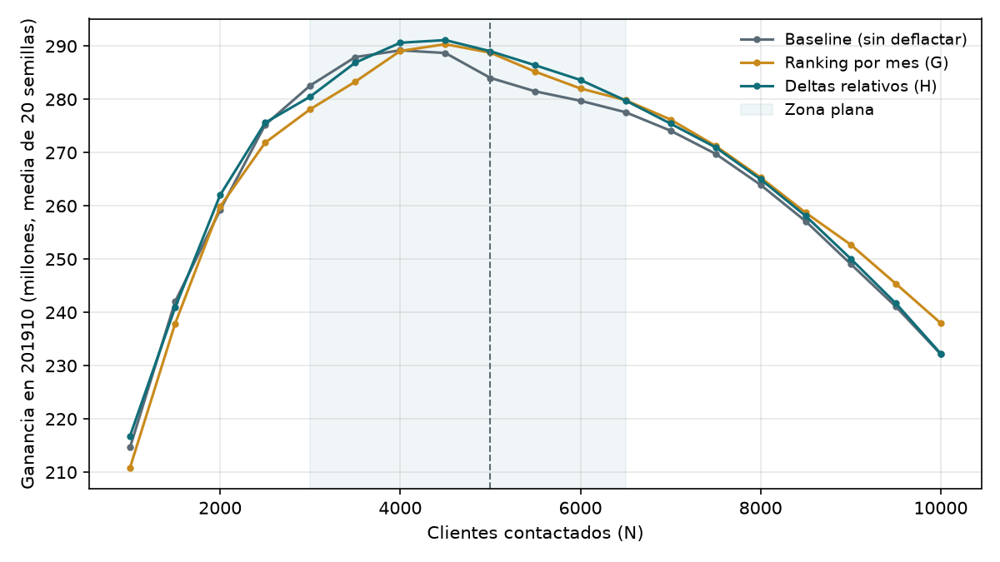

# Inflación 1

**Problema:** Data drifting (preprocesamiento: corrección del drifting con índices económicos, tipos de cambio o rankings).

**Pregunta:** ¿Es posible mejorar la ganancia del modelo de churn deflactando las variables monetarias, y en particular deflactando cada grupo de variables con su propio índice?

**Grupo:** Manuel Marasco · Alejandro Esquivel · Alexander Arias

Repositorio: https://github.com/esqale/dmeyf2026-experimento. Las decisiones están numeradas en `DECISIONES.md` (D = decisión, R = resultado). Las referencias entre paréntesis, como (R15), remiten ahí.

---

## 01 · Hipótesis experimental

**Deflactar** es llevar un monto a los precios de un mes de referencia, para poder comparar montos de meses distintos: monto deflactado = monto ÷ índice del mes × índice del mes de referencia.

Por ejemplo, si el IPC de enero de 2019 es 100 y el de enero de 2020 es 200, un saldo de $60.000 en enero de 2020 equivale a $30.000 de enero de 2019. Sin deflactar, ese cliente parece tener más plata que otro con $50.000 en enero de 2019; deflactado, tiene menos.

> **Hipótesis:** usar un deflactor distinto para cada grupo de variables da más ganancia que dividir todas las variables por el IPC, y deflactar da más ganancia que no deflactar.

**Por qué lo creíamos.** Las variables del banco no se mueven todas igual. Un consumo sigue a los precios mes a mes. Una comisión está quieta y de golpe salta. Un límite de tarjeta puede quedar congelado un año. Si se dividen las tres por el IPC, se corrige la primera y a las otras dos se les agrega una caída que nunca existió.

**Qué esperábamos ver:** sin deflactar < todo con IPC < cada grupo con su deflactor.

**Cómo sabríamos que nos equivocamos:** si los dos brazos deflactados empatan entre sí, si el de grupos pierde, o si ninguno le gana al modelo sin deflactar.

**Objetivos específicos**
1. **Índice del mes anterior.** Al predecir un mes, su IPC todavía no está publicado. Medir cuánto cuesta usar el del mes anterior en lugar del verdadero.
2. **Ruido.** Medir cuánto se mueve la ganancia por azar (semilla), para saber qué diferencias son reales.
3. **Clasificación.** Asignar cada una de las 73 columnas monetarias a un grupo y a un deflactor, con la justificación de cada asignación.
4. **Comparación principal.** Sin deflactar, todo dividido por el IPC, y cada grupo con su deflactor.
5. **Deflactar contra no deflactar.** La pregunta previa a la del deflactor por grupo: determinar si deflactar mejora la ganancia frente a no deflactar.

**Pruebas agregadas después.** Al ver los resultados de la comparación principal agregamos variantes de la deflactación (otro índice para los saldos, un deflactor sacado del propio dato, devolverle el mes al modelo), un diagnóstico de por qué deflactar no ayuda, y correcciones de la inflación que no dividen los montos por un índice (ranking dentro del mes, deltas relativos). Cada una tiene su criterio escrito en `DECISIONES.md` antes de correrla.

---

## 02 · Bibliografía

Las marcadas con * se conocen solo por resumen o por fragmentos, y hay que verificarlas contra el texto completo antes de citarlas textualmente. El detalle de la búsqueda está en `docs/investigacion_bibliografica.md`.

**Qué es deflactar y por qué por grupo**
- *Consumer Price Index Manual: Concepts and Methods* (FMI y otros, 2020)*. Define qué es un índice de precios y para qué se usa. Su capítulo 10 (*Scanner Data*) respalda construir un índice a partir de los propios registros de transacciones, que es lo que hicimos con las comisiones.
- *System of National Accounts 2008*, cap. 15 (ONU y otros)*. Distingue valores a precios corrientes y constantes.
- *Handbook on Prices and Volume Measures in National Accounts* (Eurostat, 2016)*. Recomienda deflactar cada flujo con el índice que le corresponde (método A) antes que con un índice general. Es la base de nuestra hipótesis.
- NIC 29 / RT 6 (FACPCE)*. **Van en contra de la hipótesis por grupo:** para reexpresar estados contables piden un único índice general (en Argentina, el IPC nacional empalmado con el IPIM), y solo ajustan por contrato las partidas indexadas, como los préstamos UVA (CER).

**Las series usadas como deflactores**
- INDEC, IPC nacional, base dic-2016 = 100, y su calendario de publicación: el IPC de un mes se publica a mediados del mes siguiente.
- Secretaría de Seguridad Social, RIPTE (Res. SSS 3/2021)*.
- BCRA: tasa de plazo fijo a 30 días, tipo de cambio de referencia (Com. "A" 3500) y CER (Decreto 214/2002; Com. "A" 6069 para la UVA).
- Siddiqi, *Intelligent Credit Scoring* (2017)*. El cociente saldo/límite ("utilización") es una variable estándar en scoring; respalda reemplazar los límites por el uso del límite.

**Árboles e inflación**
- Breiman et al. (1984), citado por Galili y Meilijson (2016, arXiv:1611.04561): los árboles son invariantes a transformaciones monótonas de cada variable. Dividir todo el dataset por un mismo número no cambia nada; solo puede importar un cambio distinto en cada mes.
- Ke et al. (2017), *LightGBM*. Cada variable se agrupa en contenedores con bordes calculados sobre todo el entrenamiento.
- Gama et al. (2014), *A Survey on Concept Drift Adaptation*. Marco general de datos que cambian con el tiempo.
- Shafir, Diamond y Tversky (1997), *Money Illusion**. Las personas piensan en valores nominales. Respalda la idea de que el monto en pesos, sin deflactar, puede tener información propia.

**Práctica sobre este mismo problema**
- No encontramos trabajos publicados que comparen variables deflactadas contra nominales en modelos de clientes bancarios con inflación alta. Lo más cercano son trabajos sobre estabilidad poblacional en scoring (du Pisanie et al., 2023)* y recomendaciones de política sin prueba empírica.
- Rossi (2019), "Ajuste por inflación" (RPubs), con este mismo banco: el ranking por percentil **sin cero fijo** salió peor que el nominal, y deflactar por IPC o dólar no superó claramente al nominal. Diseño débil: 4 variables y un solo mes de entrenamiento.
- Repositorios de alumnos de DMEyF 2026 (Dominguez; Larrea y Carraud*; otros*): usan el ranking por mes **con cero fijo** y reportan mejoras chicas, del orden del ruido entre semillas.
- Grupo de 2023, "Data Drifting" (ejemplo de la plantilla): deflactó las 73 variables por IPC, tuvo el mismo problema con las variables en dólares y no encontró papers sobre el tema.

**Método de comparación**
- Dietterich (1998), *Neural Computation* 10(7). Por qué una sola corrida no alcanza para comparar modelos.
- Demšar (2006), *JMLR* 7. Recomienda el test de Wilcoxon de rangos con signo para comparar dos modelos; lo usamos pareado por semilla.
- Kaufman et al. (2012), *Leakage in Data Mining*, ACM TKDD 6(4). Usar un dato que no existía al momento de predecir es una fuga de información; justifica el objetivo 1.

---

## 03 · Sesgos cognitivos

Lo que creíamos antes de correr los experimentos, y lo que podía jugar en contra de una lectura honesta:
- **La hipótesis es nuestra.** Planteamos el brazo por grupo y dedicamos varios días a clasificar las 73 columnas. Nos convenía que ese trabajo se notara en la ganancia.
- **La inflación molesta.** Creíamos que una inflación del 54% anual tenía que molestarle al modelo, y que corregirla iba a mejorarlo.
- **Querer un resultado.** Después del primer resultado negativo, nos interesaba encontrar alguna corrección que sí funcionara, para que el trabajo no terminara en "no funcionó". Por eso las pruebas agregadas después tienen su criterio escrito antes de correrlas.

**Cómo nos cuidamos de estos sesgos:** el criterio de cada prueba agregada después se escribió antes de correrla (D15, D17–D23), todas las comparaciones usan las mismas 20 semillas y un test pareado, y los dos resultados que más nos convenían ("por grupo gana" y después los deltas relativos) se volvieron a probar con hiperparámetros propios.

---

## 04 · Diseño experimental

### Datos
- Dataset de la segunda competencia, solo 2019: 154 columnas, un parquet por mes.
- **Clase:** BAJA+1 = el cliente no está en t+1; BAJA+2 = está en t+1 y no en t+2. Hay clase para 201901–201910. 201911 y 201912 solo sirven para armar la clase de 201910.
- **Columnas rotas que se dejan como están (D4):** siete columnas de comisiones y rentabilidad valen 0 para todos los clientes en 201905 y en 201910. Es lo más fiel a cómo llegan los datos en la realidad.
- **Hallazgos al clasificar las columnas monetarias (D10, D14):**
  - Los consumos, pagos y adelantos en dólares de tarjeta están en USD (no se mueven con el dólar). Los saldos en dólares están en pesos al tipo de cambio.
  - Las etiquetas de plazo fijo parecen cruzadas: `mplazo_fijo_pesos` sigue al dólar de forma exacta, y `mplazo_fijo_dolares` no se mueve con el dólar y su moda es 117.300 = 100.000 × 1,173.
  - No hay préstamos que se muevan como UVA ni columnas en pesos de mora o punitorios: los grupos CER y tasa activa de la hipótesis quedan vacíos.
  - Los montos están multiplicados por 1,173 (anonimización). Es un factor constante y no afecta.

### Modelo base (común a todas las pruebas)

| Qué | Cómo |
|---|---|
| Variables | 152 originales + lag 1 y 2 + delta 1 y 2 = 760. El lag es por calendario: si el cliente no estaba ese mes, queda vacío. 201901–02 se usan solo como historia para los lags. |
| Modelo | LightGBM, objetivo binario. Para entrenar se juntan BAJA+1 y BAJA+2 como positivos. |
| Optuna | 50 intentos (TPE, semilla 102191) sobre `learning_rate`, `num_leaves`, `min_data_in_leaf`, `feature_fraction` y `bagging_fraction`. Entrena con 201903–06 y **valida en 201908 maximizando el AUC**, con early stopping de 100 rondas. |
| Envíos | N = 5.000, el máximo de la curva de ganancia del mejor intento en 201908 (cortes de a 500). |
| Test | Se reentrena con 201903–08 con los mismos hiperparámetros e iteraciones, y se mide en **201910** (632 BAJA+2). |
| Ganancia | +1.072.500 por cada BAJA+2 contactado y −27.500 por cada contacto. |

### Cómo se compara
- **20 semillas, siempre las mismas** (generadas desde 102191) en todas las pruebas. Cada prueba se compara de a pares con su referencia, semilla por semilla, con el test de Wilcoxon (bilateral).
- **Métrica principal:** ganancia con N = 5.000.
- **Métricas de apoyo:** ganancia promedio en la **zona plana** (3.000 a 6.500 envíos, donde la curva del baseline es plana; tiene la mitad de ruido), **máximo de la curva** (optimista, porque supone conocido el mejor N del test) y **AUC** de 201910.
- **Criterio:** con p < 0,05 en la métrica principal se dice que la prueba *mejora* o *empeora*; si no, que *empata*. Para todas las pruebas agregadas después de la comparación principal (desde IPC + `foto_mes`), el criterio se escribió antes de correrlas.

### Familia 1 · Medir el ruido (objetivo 2)
El modelo base, sin cambiar nada, con las 20 semillas. Sirve de vara para todas las demás diferencias. Como sensibilidad, se mide también el modelo sin reentrenar (solo 201903–06).

### Familia 2 · Dividir los montos por un índice (objetivos 1, 3, 4 y 5)
La deflactación se aplica **antes** de calcular lags y deltas: cada valor se divide por el índice de su propio mes (el lag 1 por el de t−1, y así). Índices normalizados a 201901 = 1.

**Brazos principales**
- **Sin deflactar** (baseline).
- **Todo con IPC:** las 73 columnas monetarias divididas por el IPC del mes anterior. Para el objetivo 1, también con el IPC del mismo mes.
- **Por grupo:** cada grupo con su deflactor (D14, detalle en `docs/paso10_clasificacion.md`):

| Grupo | Columnas | Deflactor | Mes del índice |
|---|---|---|---|
| Consumos, movimientos en pesos, préstamos, rentabilidad y márgenes | 43 | IPC | anterior |
| Sueldo | `mpayroll`, `mpayroll2` | RIPTE | anterior |
| Saldos en pesos | 7 + `mplazo_fijo_dolares` | Tasa de plazo fijo a 30 días acumulada | mismo |
| Dólares expresados en pesos | 5 (incluye `mplazo_fijo_pesos`) | Tipo de cambio de fin de mes | mismo |
| Compra y venta de dólares | `mforex_buy`, `mforex_sell` | Tipo de cambio promedio del mes | mismo |
| Comisiones | 3 | Moda mensual de la comisión de mantenimiento | mismo |
| Límites de tarjeta | 4 | Se reemplazan por consumo ÷ límite y saldo ÷ límite | — |
| Consumos y pagos en dólares de tarjeta | 6 | Ninguno (están en USD) | — |

Series concretas: IPC nacional (INDEC, `148.3_INIVELNAL_DICI_M_26`), RIPTE (`158.1_REPTE_0_0_5`), tasa de depósitos a 30 días (BCRA, id 12), tipo de cambio Com. "A" 3500 (BCRA, id 5). Controles: inflación 2019 = 53,8%, igual que INDEC (`datos_externos/FUENTES.md`).

**Chequeo de robustez**
- **Optuna propia por brazo:** los brazos IPC y por grupo con su propia búsqueda de 50 intentos, para descartar que el baseline gane solo porque los hiperparámetros se eligieron para él.

**Variantes agregadas después**
- **IPC + `foto_mes`** (con hiperparámetros del baseline y con Optuna propia): prueba si deflactar empeora porque le saca al modelo la pista de qué mes es cada fila.
- **Por grupo con IPC en los saldos:** cambia la decisión más discutible de la clasificación.
- **Mediana del mes:** cada columna dividida por la mediana de sus valores distintos de 0 en el mes. Es un deflactor sacado del propio dato, sin índice externo.
- **Por grupo + `foto_mes`:** completa el chequeo del mes para el brazo por grupo.

### Familia 3 · Por qué deflactar no ayuda (diagnóstico, agregada después)
- **Validación adversarial de los montos (D17):** un LightGBM intenta distinguir 201903 de 201910 usando solo las 73 columnas monetarias, nominales, con IPC y por grupo (5 semillas). También el AUC de cada columna sola. Pregunta: ¿deflactar les saca el drift a los montos?
- **Dónde cortan los árboles (D18):** sobre el modelo final del baseline se miran todos los cortes en variables monetarias: cuánto gain está en cortes en 0, a qué montos cortan, y cuántos clientes de 201910 cambian de lado de cada corte si se deflacta con IPC.

### Familia 4 · Corregir la inflación sin dividir los montos (agregada después, fuera de la hipótesis)
Un árbol no cambia si a todos los meses se les aplica la misma transformación monótona. Por eso solo puede cambiar algo una corrección que trate distinto a cada mes, o que cambie cómo se calculan los lags y deltas (D19–D20).

- **G · Ranking por mes con cero fijo, antes de lags y deltas.** En cada mes, cada monto pasa a la posición del cliente entre todos los clientes del mes: el 0 queda en 0, los positivos van de 0 a 1 y los negativos de 0 a −1. Lags y deltas se calculan después, sobre las posiciones.
- **G2 · Ranking después de lags y deltas.** Lags y deltas en pesos, y después se rankea todo dentro del mes. Separa si lo que importa es rankear los niveles o los deltas.
- **G0 · Ranking sin cero fijo.** Como G, pero los ceros entran al ranking como cualquier otro valor. Control: Rossi (2019) usó esta versión.
- **M · Pesos + ranking.** Las 760 variables en pesos más las 365 monetarias de G (1.125 en total). El modelo elige cuál usar. Prueba si el monto en pesos tiene información propia: además de la ganancia, se mide qué parte del gain va a cada versión.
- **H · Deltas relativos.** Montos del mes y lags en pesos, sin tocar. Solo los deltas de las 73 monetarias pasan a ser una tasa de crecimiento: `slog(x_t) − slog(x_{t−k})`, con `slog(x) = signo(x) · ln(1 + |x|)`. Funciona con ceros y negativos, y no depende del nivel de precios.
  - *Ejemplo:* un cliente con un saldo que pasa de 20.000 a 10.000 y otro que pasa de 2.000.000 a 1.990.000 tienen el mismo delta en pesos (−10.000). Como tasa, el primero vació media cuenta (−50%) y el segundo casi no cambió (−0,5%). Además, una inflación del 4% mensual le suma ~4% a la tasa de todos los clientes por igual, así que no cambia el orden entre ellos; en pesos, en cambio, agranda los deltas de los clientes con montos grandes y mezcla "el cliente cambió" con "subieron los precios".
- **H en un segundo mes de test (D21).** Para confirmar H: test en **201909**, entrenando con 201903–07 (misma regla, hasta t−2), con los mismos hiperparámetros, semillas, N y zona plana, sin ajustar nada. Baseline y H.

**Por qué este diseño.** Con 20 semillas, la diferencia media entre dos brazos tiene un error de ~1 M, así que una diferencia de 2–3 M se distingue del azar (comparar de a pares no reduce el ruido: la misma semilla no da resultados parecidos en dos brazos distintos). La Optuna propia por brazo separa el efecto de deflactar del efecto de los hiperparámetros. Las variantes de la familia 2 descartan que el problema sea un índice mal elegido. La familia 3 busca el mecanismo. La familia 4, agregada después, prueba la otra mitad del problema de la plantilla: corregir el drift con rankings.

---

## 05 · Limitaciones

**Por qué los experimentos podrían no responder la pregunta**
- **Casi todo se mide en un solo mes de test (201910).** Solo baseline y H se repitieron en 201909. Con 632 BAJA+2 en 201910, unas decenas de aciertos más o menos mueven la ganancia en decenas de millones.
- **La ventana es corta y de un solo año.** Entre 201903 y 201910 el IPC sube ~27%. Con más inflación o ventanas más largas el resultado podría cambiar.
- **El mes de test cae en un período atípico:** justo después de las PASO de agosto y del cepo de septiembre, con un dólar que salta 35% en agosto (tipo de cambio de fin de mes, 1,347). No sabemos si el resultado vale igual en un período normal.
- **Columnas rotas en el mes de test.** En 201910 las comisiones y la rentabilidad valen 0 para todos, así que ningún deflactor puede cambiar algo en esas columnas ese mes. Además, `mtransferencias_recibidas` casi no existe antes de 201906 (0,1% de clientes, contra 55–62% desde junio). Afecta a todos los brazos por igual.

**Problemas posibles del diseño**
- **Hiperparámetros del baseline.** La comparación principal y todas las pruebas de la familia 4 usan los hiperparámetros elegidos para el modelo sin deflactar. La familia 2 y H se chequearon con Optuna propia. G, G2, G0 y M no.
- **N y zona plana se fijaron con el baseline.** N = 5.000 se eligió en 201908, sin mirar el test. La zona plana (3.000–6.500) se definió mirando la curva del baseline en 201910. Al definirla después en validación (201908, regla del 95% del máximo) da 3.000–6.000, y ninguna conclusión cambia (R21).
- **Clasificación propia.** Los grupos de deflactores son una decisión nuestra (D14). Que las etiquetas de plazo fijo estén cruzadas se dedujo de los datos, no está confirmado por la fuente.
- **`foto_mes` fuera de rango.** En los brazos con `foto_mes`, el mes de test queda fuera del rango de entrenamiento y el árbol lo trata como el último mes visto. Esos brazos prueban "devolverle el mes" solo hasta donde un modelo puede usar un mes que no vio.
- **El mes de referencia del índice no es una limitación:** cambiarlo multiplica todo el dataset por una constante, y los árboles son invariantes a eso.

**Problemas en las corridas**
- La Optuna de cada brazo tiene 50 intentos. Los mejores intentos quedan a menos de 0,0005 de AUC entre sí, y su ganancia en 201908 no sigue el orden del AUC.

---

## 06 · Resultados

Diferencias contra el baseline en millones de pesos. "Gana" = semillas, de 20, en las que la prueba supera a su referencia. p = Wilcoxon pareado.

**Vista general:** todas las pruebas contra el baseline, en las dos métricas.



### Familia 1 · Ruido

| Métrica (baseline, 20 semillas, test 201910) | Media | Desvío | Rango |
|---|---|---|---|
| Ganancia con N = 5.000 | 284,0 M | 3,3 M | 279,4–289,3 M |
| Ganancia en la zona plana | 283,9 M | 1,9 M | — |
| Máximo de la curva | 290,5 M | 2,1 M | siempre entre 3.500 y 4.500 envíos |
| AUC 201910 | 0,9375 | 0,0004 | — |

- El intervalo de confianza del 95% de la media con N fijo es ±1,5 M.
- Sin reentrenar (solo 201903–06), con la misma semilla: 281,6 M, igual que reentrenando.
- En 201909 (entrenando con 201903–07): 252,4 ± 3,6 M con N fijo y 251,7 ± 1,7 M en la zona plana.



### Familia 2 · Dividir por un índice

| Prueba | Optuna | N = 5.000 | Gana | p | Zona plana | Gana | p | Máximo | AUC |
|---|---|---|---|---|---|---|---|---|---|
| Baseline (sin deflactar) | propia | 284,0 | — | — | 283,9 | — | — | 290,5 | 0,9375 |
| Todo con IPC, mes anterior | baseline | −1,8 | 6 | 0,14 | −4,9 | 0 | 0,0001 | −5,3 | 0,9374 |
| Todo con IPC, mismo mes | baseline | −0,1 | 9 | 0,81 | −3,5 | 2 | < 0,0001 | −3,9 | 0,9373 |
| Por grupo | baseline | +0,4 | 8 | 0,69 | −3,5 | 1 | 0,0001 | −3,6 | 0,9373 |
| Todo con IPC | propia | −2,1 | 4 | 0,013 | −5,8 | 0 | 0,0001 | −6,5 | 0,9360 |
| Por grupo | propia | −2,5 | 7 | 0,08 | −5,2 | 0 | 0,0001 | −5,9 | 0,9357 |
| IPC + `foto_mes` | baseline | −1,1 | 7 | 0,14 | −4,3 | 1 | 0,0002 | −4,8 | 0,9373 |
| IPC + `foto_mes` | propia | −2,8 | 6 | 0,04 | −6,1 | 1 | 0,0001 | −6,1 | 0,9365 |
| Por grupo, saldos con IPC | baseline | +0,2 | 8 | 0,78 | −3,0 | 1 | 0,0003 | −3,8 | 0,9372 |
| Mediana del mes | baseline | −0,3 | 8 | 0,66 | −1,8 | 5 | 0,008 | −1,5 | 0,9375 |
| Por grupo + `foto_mes` | baseline | −1,2 | 8 | 0,24 | −4,4 | 1 | 0,0001 | −5,7 | 0,9373 |



**Comparaciones entre brazos**

| Comparación | N = 5.000 | Gana | p | Zona plana | Gana | p |
|---|---|---|---|---|---|---|
| Por grupo contra IPC (hiperparámetros del baseline) | +2,1 | 14 | 0,017 | +1,4 | 14 | 0,002 |
| Por grupo contra IPC (cada uno con Optuna propia) | −0,4 | — | 0,84 | +0,6 | — | 0,28 |
| IPC mismo mes contra mes anterior (objetivo 1) | +1,7 | 12 | 0,04 | +1,4 | 13 | 0,015 |
| IPC + `foto_mes` contra IPC | +0,7 | 8 | 0,49 | +0,6 | 13 | 0,31 |
| IPC + `foto_mes` contra IPC (Optuna propia) | −0,7 | 10 | 0,68 | −0,3 | 7 | 0,55 |
| Por grupo con saldos con IPC contra por grupo | −0,2 | 8 | 0,94 | +0,5 | 14 | 0,20 |
| Mediana del mes contra IPC | +1,5 | 10 | 0,13 | +3,1 | 17 | 0,0003 |
| Por grupo + `foto_mes` contra por grupo | −1,5 | 4 | 0,10 | −0,9 | 7 | 0,046 |

AUC de validación (201908) del mejor intento de cada Optuna: baseline 0,93294 · IPC 0,93248 · por grupo 0,93222 · IPC + `foto_mes` 0,93191.

### Familia 3 · Diagnóstico

**Validación adversarial (201903 contra 201910, solo las 73 columnas monetarias)**

| | Nominal | Con IPC | Por grupo |
|---|---|---|---|
| AUC del modelo que distingue los meses | 1,000 | 1,000 | 1,000 |
| Mediana del AUC por columna, como drift (\|AUC − 0,5\|) | 0,0114 | 0,0083 | 0,0077 |
| Columnas con drift > 0,05 | 14 | 10 | 10 |

- La columna que más separa los meses en todas las corridas es `mrentabilidad_annual`.
- Las columnas con más drift son cortes de datos: rentabilidad, márgenes y comisiones (0 en 201910) y `mtransferencias_recibidas` (casi inexistente antes de 201906).
- En consumos de tarjeta, saldos y límites, el AUC por columna baja de ~0,55 a ~0,51 al deflactar.
- Con 201908 contra 201910 no hay diferencias entre los tres.



**Cortes de los árboles (modelo final del baseline)**

| | Valor |
|---|---|
| Cortes en total / en variables monetarias | 41.715 / 27.573 |
| Gain de las variables monetarias sobre el total | 51,5% |
| Gain monetario en cortes con \|umbral\| ≤ 1 peso | 6,4% |
| Gain monetario con \|umbral\| ≤ 100 / 1.000 / 10.000 pesos | 19,7% / 48,2% / 81,9% |
| Clientes de 201910 que cambian de lado de un corte al deflactar con IPC (promedio) | 2,1% (máximo: `mcaja_ahorro`, 2,9%) |

### Familia 4 · Corregir sin dividir

| Prueba | N = 5.000 | Gana | p | Zona plana | Gana | p | Máximo | AUC |
|---|---|---|---|---|---|---|---|---|
| G · Ranking por mes | +4,7 | 16 | 0,001 | +0,7 | 14 | 0,13 | +1,0 | −0,0003 |
| G2 · Ranking después de deltas | −0,3 | 10 | 0,76 | −0,7 | 9 | 0,15 | −1,3 | = |
| G0 · Ranking sin cero fijo | −1,6 | 5 | 0,17 | −4,6 | 1 | 0,0001 | −4,3 | −0,0042 |
| M · Pesos + ranking | +3,4 | 15 | 0,007 | +1,0 | 15 | 0,04 | +0,9 | −0,0002 |
| **H · Deltas relativos** | **+5,0** | **17** | **0,0008** | **+2,1** | **18** | **0,002** | **+2,1** | −0,0002 |
| **H · test 201909** (contra el baseline de 201909) | **+5,2** | **18** | **0,0005** | **+3,2** | **20** | **0,0001** | **+3,8** | −0,0003 |
| **H · Optuna propia** (contra el baseline, que tiene la suya) | **+3,9** | **16** | **0,003** | **+1,7** | **14** | **0,013** | **+3,0** | −0,0004 |

**Comparaciones entre pruebas**

| Comparación | N = 5.000 | Gana | p | Zona plana | Gana | p |
|---|---|---|---|---|---|---|
| G2 contra G | −5,1 | 2 | 0,0004 | −1,4 | 5 | 0,004 |
| G0 contra G | −6,3 | 1 | 0,0003 | −5,2 | 0 | 0,0001 |
| M contra G | −1,3 | 7 | 0,17 | +0,4 | 10 | 0,32 |
| H contra G | +0,3 | 10 | 0,65 | +1,4 | 17 | 0,001 |
| H contra M | +1,6 | 16 | 0,04 | +1,0 | 15 | 0,011 |
| H contra IPC | +6,8 | — | — | +7,0 | — | — |
| H con Optuna propia contra H | −1,2 | 5 | 0,14 | −0,4 | 8 | 0,34 |

**Reparto del gain en M** (3 modelos finales): las monetarias se llevan el 56% del gain total. Dentro de las monetarias, las versiones en pesos se llevan el 50% (46%, 50% y 54% según la semilla) y las rankeadas el otro 50%. `mcaja_ahorro` es la 2.ª variable más importante y `mcaja_ahorro_rk` la 3.ª.

**Ganancia según el N elegido** (diferencia contra el baseline, 201910):

| Envíos | 1.000–3.500 | 4.000–4.500 | 5.000–6.000 | 6.500–8.500 | 9.000–10.000 |
|---|---|---|---|---|---|
| G | pierde (−3,4 a −4,6; p < 0,005), salvo 2.000 | empata | gana (+2,3 a +4,7) | gana poco (+1,4 a +2,3) | gana (+3,6 a +5,8) |
| H | parejo: gana en 1.000 y 2.000 (+2,1 y +2,8), pierde en 3.000 (−2,1; p = 0,007) | gana en 4.500 (+2,4) | gana (+3,9 a +5,0) | empata | empata |

El pico de la curva del baseline está en 4.000 envíos (289,2 M), el de G en 4.500 (290,3 M) y el de H en 4.500 (291,1 M).

**Zona plana definida en validación** (R21): con la curva del baseline en 201908, la zona con ganancia ≥ 95% del máximo va de 3.000 a 6.000 envíos. Recalculada para todas las pruebas, ningún veredicto cambia: H +2,1 M (17/20, p 0,002), M +1,1 M (p 0,03), G +0,5 M (p 0,20) y todos los brazos que dividen por un índice pierden. Detalle en `reportes/zona_validacion/comparacion.csv`.




---

## 07 · Discusión

### Resultados ↔ hipótesis
- **La hipótesis no se confirma en ninguna de sus dos partes.**
  - *Deflactar contra no deflactar (objetivo 5):* ningún brazo deflactado le gana al baseline. Con N fijo empatan o pierden; en la zona plana pierden en casi todas las semillas, con los hiperparámetros del baseline y con Optuna propia.
  - *Por grupo contra IPC:* por grupo gana con los hiperparámetros del baseline (+2,1 M), pero empata cuando cada brazo tiene su propia Optuna. Es una diferencia chica que depende de la configuración.
- **Los montos importan, pero deflactarlos no ayuda.** Las variables monetarias explican la mitad del gain del modelo, y `mcaja_ahorro` es la segunda variable más importante. El modelo no ignora los montos: los usa mucho.
- **Objetivo 1:** usar el IPC del mes anterior, que es el único disponible al predecir, cuesta ~1,5 M frente al del mismo mes. Es chico pero consistente.
- **Objetivo 2:** con una sola semilla, el ruido (±3,3 M) es del tamaño de los efectos que buscamos. Sin 20 semillas y sin el chequeo de Optuna propia, el +2,1 M de "por grupo" lo habríamos reportado como hallazgo.

### Familia ↔ familia
- **Por qué deflactar no ayuda (familias 2 y 3).**
  - *No es la pista del mes:* agregar `foto_mes` no recupera nada, ni con los hiperparámetros del baseline ni con Optuna propia.
  - *No es el cero:* solo el 6% del gain monetario está en cortes en 0. Los cortes caen en montos chicos (la mitad, hasta ±1.000 pesos), y al deflactar en cada corte cambia de lado solo el ~2% de los clientes. Deflactar mueve poco el recorrido por el árbol.
  - *El drift que corrige es chico:* el drift fuerte de los montos son cortes de datos que ningún deflactor toca. Deflactar corrige el drift por inflación de consumos y saldos, pero ese drift ya era chico.
  - *El índice no describe bien a las columnas:* los saldos crecen 1,36–1,43 en el año, y ni la tasa (1,53) ni el IPC (1,50) los siguen. La mediana del propio dato, columna por columna, pierde menos que el IPC. Igual, ningún índice le gana al baseline.
- **Por qué funciona corregir sin dividir (familias 3 y 4).**
  - Las dos correcciones que ganan, H y G, cambian cómo se mide el *cambio* del cliente entre meses. Coincide con la familia 3: los cortes sobre los montos del mes casi no se mueven al corregir, así que lo que quedaba por mejorar estaba en los deltas.
  - Un delta en pesos mezcla lo que cambió el cliente con lo que cambiaron los precios, y además crece con el nivel del cliente: 10.000 pesos menos no significan lo mismo con un saldo de 20.000 que con uno de 2 millones. La tasa (H) y el cambio de posición (G) separan esas dos cosas.
  - Deflactar con IPC también corrige el delta, pero divide todos los montos y pierde el nivel nominal. H se queda con los montos en pesos y corrige solo el cambio. Que M reparta el gain mitad y mitad entre pesos y ranking apunta en la misma dirección: el modelo no descarta el monto en pesos aunque tenga una versión corregida.
  - En el ranking importan dos detalles: rankear **antes** de calcular los deltas (G2 empata) y **fijar el cero** (G0 pierde en todo). Sin cero fijo, "no tiene el producto" queda pegado a "tiene muy poco".
- **La ventaja de H no es un efecto de los hiperparámetros.** Con su propia Optuna sigue ganándole al baseline (+3,9 M con N fijo, +1,7 M en la zona plana) y empata con H con los hiperparámetros del baseline. Es el chequeo que hizo caer la ventaja de "por grupo" sobre IPC, y H lo pasa.
- **H y G mejoran la parte de la lista donde cortamos, no el orden de todos los clientes.** El AUC no mejora en ninguna prueba. G empeora a los primeros clientes de la lista y mejora a los siguientes; H casi no pierde en ningún tramo. Por eso la ventaja de H es más robusta al N elegido.

### Problema ↔ otros problemas
- **Grupo de 2023 ("Data Drifting"):** deflactó todo por IPC y se encontró con el mismo problema de las variables en dólares. Nuestro trabajo lo extiende con el brazo por grupo, la medición del ruido y el chequeo de hiperparámetros, y llega a la misma conclusión sobre deflactar.
- **Rossi (2019):** con este mismo banco, el ranking sin cero fijo salió peor que el nominal. Coincide con nuestra G0, y G muestra que fijar el cero cambia el resultado.
- **Repositorios de DMEyF 2026:** reportan mejoras chicas con el ranking con cero fijo, sobre datos de 2021 y con un solo mes de evaluación. Con 20 semillas pareadas, G gana con N fijo pero empata en la zona plana: la mejora existe, pero depende del corte.
- **NIC 29 / RT 6:** piden un único índice general. La norma contable no busca predecir, pero coincide con lo que encontramos: los índices por grupo no tienen una ventaja robusta sobre un índice general.
- **Literatura:** no encontramos trabajos publicados que comparen montos deflactados contra nominales en modelos de clientes con inflación alta. Hasta donde sabemos, el resultado de los deltas relativos es evidencia nueva.

---

## 08 · Conclusiones

En el churn de 2019, con un modelo LightGBM de lags y deltas, **dividir las variables monetarias por un índice no mejora la ganancia**, se use el índice que se use: IPC, un índice por grupo de variables o la mediana de cada columna en el mes. El modelo sin deflactar es igual o mejor en las 20 semillas, también con hiperparámetros propios para cada brazo.

- Deflactar por grupo le ganó a deflactar todo por IPC solo con los hiperparámetros del baseline. Con hiperparámetros propios empatan, así que esa ventaja no es robusta. La hipótesis original no se confirma en ninguna de sus dos partes.
- **Fuera de la hipótesis, corregir la inflación sin dividir los montos sí mejora la ganancia.** Lo que funciona es medir los *cambios* de cada monto sin que dependan del nivel de precios:
  - Con deltas relativos (tasa de crecimiento en lugar de diferencia en pesos, con los montos del mes nominales), la ganancia sube +5,0 M con N fijo y +2,1 M en la zona plana en 201910. En un segundo mes de test, 201909, se repite: +5,2 M con N fijo y +3,2 M en la zona plana, a favor en las 20 semillas. Y se sostiene con hiperparámetros propios: +3,9 M con N fijo y +1,7 M en la zona plana.
  - El ranking del cliente dentro de su mes, con el cero fijo, mejora con el N del esquema pero no en la zona plana.
  - Es todo 2019: antes de recomendarlo hay que confirmarlo en otros años (ver Futuros).
- **Recomendación práctica:**
  - No dividir los montos por un índice: cuesta trabajo y resta ganancia.
  - Si igual se deflacta, usar el índice del mes anterior, el único disponible al predecir. Cuesta poco (1,4–1,7 M).
  - Antes de corregir nada, medir qué está cambiando entre meses con una validación adversarial.
  - Confirmar los deltas relativos en otros años y con más inflación.

---

## 09 · Futuros problemas y experimentos

**Nuevas preguntas** (por resultados no intuitivos)
- Deflactar cambia de lado de un corte a solo el ~2% de los clientes de 201910 (R11). ¿Cómo puede entonces costar 3,5 a 4,9 M en la zona plana, en casi todas las semillas?
- Si lo que se pierde al deflactar es el monto nominal (R6), ¿el monto en pesos informa por sí mismo? M quedó en el límite (el modelo reparte el gain mitad y mitad). Hace falta una prueba más directa, por ejemplo sacar los montos del mes y dejar solo lags y deltas.
- Los deltas relativos suben la ganancia sin mejorar el AUC. ¿Mejoran el orden solo cerca del corte? ¿Qué clientes cambian de lugar entre los envíos 4.000 y 6.000?

**Extensiones**
- **Confirmar los deltas relativos** en otros años y con más inflación, en particular 2020–2021, donde el drift por precios podría pesar más. Hoy están probados solo en 201909 y 201910.
- **Combinar** deltas relativos con el ranking en los niveles: las dos correcciones que funcionaron actúan sobre cosas distintas (el cambio entre meses y el nivel dentro del mes). También probar cocientes entre columnas del mismo cliente y mes (uso del límite, consumo sobre saldo), que no dependen de ningún deflactor.
- **Optuna propia para G y M**, que todavía usan los hiperparámetros del baseline.

---

## 10 · Anexo

Todo está en https://github.com/esqale/dmeyf2026-experimento (rama `main`). El `README.md` explica cómo correr todo desde el dataset de la competencia (`competencia_02_crudo.csv.gz`). Pasos comunes a todas las familias:

```bash
pip install -r requirements.txt
python src/00_convertir_a_parquet.py <ruta>/competencia_02_crudo.csv.gz historia/mensual   # un parquet por mes
python src/02_dataset.py                                                                    # dataset del baseline
python src/03_baseline.py --dataset datasets/fe_base --nombre baseline                      # Optuna + test
python src/07_comparar.py <referencia> <brazo> [...] --salida <archivo.csv>                 # comparación pareada
```

| Familia | Scripts | Cómo se corre | Salidas |
|---|---|---|---|
| 1 · Ruido | `04_semillas.py` | `python src/04_semillas.py --dataset datasets/fe_base --nombre baseline` · test en 201909: `--test 201909 --entrena-test 0307 --nombre baseline_t201909` · sin reentrenar: `--entrena-test 0306` | `reportes/baseline/`, `reportes/baseline_t201909/`, `reportes/sensibilidad_sin_reentreno/` |
| 2 · Dividir por un índice | `05_indices.py`, `06_monetarias.py`, `08_monedas.py`, `deflactar.py`, `02_dataset.py`, `04_semillas.py`, `03_baseline.py` (Optuna propia) | `python src/02_dataset.py --brazo ipc --desfase 1` (y `--desfase 0`, `--brazo grupo`, `grupo_saldos_ipc`, `mediana`; `--con-mes` agrega `foto_mes`) y luego `04_semillas.py --dataset datasets/fe_<brazo> --nombre <brazo>`. Optuna propia: `03_baseline.py --dataset datasets/fe_<brazo> --nombre <brazo>_opt` y `04_semillas.py --params reportes/<brazo>_opt/resultado.json` | `reportes/{ipc_d1,ipc_d0,grupo,ipc_d1_opt,grupo_opt,ipc_d1_mes,ipc_d1_mes_opt,grupo_saldos_ipc,mediana,grupo_mes}/`, `reportes/paso10/`, `datos_externos/` |
| 3 · Diagnóstico | `10_adversarial.py`, `11_cortes.py` | `python src/10_adversarial.py` · `python src/11_cortes.py` | `reportes/adversarial/`, `reportes/cortes/` |
| 4 · Corregir sin dividir | `rankear.py`, `fe.py`, `02_dataset.py`, `04_semillas.py`, `12_gain_nominal_rk.py` | `python src/02_dataset.py --brazo <ranking \| ranking_post \| ranking_sin_cero \| nominal_ranking \| delta_log>` y luego `04_semillas.py`. H en 201909: `04_semillas.py --dataset datasets/fe_delta_log --nombre delta_log_t201909 --test 201909 --entrena-test 0307`. H con Optuna propia: `03_baseline.py --dataset datasets/fe_delta_log --nombre delta_log_opt` y `04_semillas.py --params reportes/delta_log_opt/resultado.json` | `reportes/{ranking,ranking_post,ranking_sin_cero,nominal_ranking,delta_log,delta_log_t201909,delta_log_opt}/` |

- Tablas de comparación: `reportes/comparacion_todas.csv` (todas contra el baseline) y `comparacion*.csv` dentro de cada carpeta.
- Zona plana definida en validación: `python src/14_zona_validacion.py` → `reportes/zona_validacion/`.
- Figuras de Resultados (las cinco): `python src/13_figuras.py` → `docs/figuras/`.
- Las probabilidades por cliente y semilla (`probs_*.parquet`) y los datasets no están en git por tamaño: se regeneran con los scripts.
- Presentación del video: `docs/presentacion_final/index.html` (abrir en el navegador), con su guion en `docs/presentacion_final/guion.md`.
- Detalle de cada decisión y resultado: `DECISIONES.md`. Clasificación de columnas: `docs/paso10_clasificacion.md`. Búsqueda bibliográfica: `docs/investigacion_bibliografica.md`.
